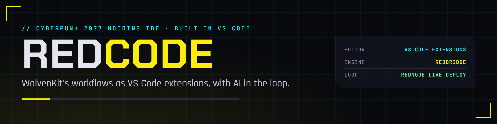
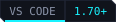

<p align="center">
  
</p>

<p align="center">
  <a href="https://cyberbuildsai.github.io/REDcode/"></a>
  
  
  
  <a href="LICENSE"></a>
</p>

A Cyberpunk 2077 modding IDE built on VS Code.

REDcode brings the workflows of [WolvenKit](https://github.com/WolvenKit/WolvenKit), browsing game archives, editing game files, importing and exporting assets, packing mods, into VS Code as extensions. WolvenKit's own C# engine does the file work inside [REDbridge](https://github.com/CyberbuildsAI/REDbridge), a local process the extensions talk to. The name is RED for REDengine and code for VS Code.

REDcode is the build-time half of an AI-first, Node-based modding ecosystem; [REDnode](https://github.com/CyberbuildsAI/REDnode) is the runtime half. A REDnode mod is edited in REDcode, deployed to the running game without a restart, debugged live, and its events stream back.

**[Read the docs](https://cyberbuildsai.github.io/REDcode/)** &middot; [REDbridge](https://github.com/CyberbuildsAI/REDbridge) &middot; [REDnode](https://github.com/CyberbuildsAI/REDnode)

> [!NOTE]
> **Status: C2 works end to end.** `redcode-core` opens WolvenKit projects, browses the game archives folder by folder, adds files or whole folders to a project, extracts them anywhere, and opens game files or project files as JSON. Next: the CR2W editor, texture viewer and TweakXL support (C3).

## How it works

```
 REDcode (VS Code extensions, MIT)     REDbridge (.NET, GPL-3.0)      REDnode (Node, runtime)
 ┌────────────────────────────────┐    ┌──────────────────────┐       ┌──────────────────────┐
 │ project explorer, asset browser│    │ WolvenKit engine     │       │ mods attached to the │
 │ CR2W, texture, mesh editors    │◄──►│ JSON-RPC over stdio  │       │ running game         │
 │ import / export / pack         │    │ MCP for AI assistants│       │ hot reload, debugger │
 │ REDnode console and debugger   │◄───┼──────────────────────┼──────►│ events and logs      │
 └────────────────────────────────┘    └──────────────────────┘       └──────────────────────┘
```

| | REDcode | REDbridge | REDnode |
|---|---|---|---|
| Role | The editor | The engine host | The runtime |
| Runs in | VS Code | A local .NET process | A Node process beside the game |
| License | MIT | GPL-3.0 (links WolvenKit) | MIT |

Everything a modder touches is text an AI assistant can read and write: game files as JSON, tweaks as YAML, scripts as TypeScript. The same bridge methods serve the extensions and an MCP server, so an assistant can work a project alongside the person using REDcode.

## Repository layout

| Path | Contents |
|---|---|
| `extensions/redcode-core/` | Bridge client, the Project and Game Assets views, project create and detect, add to project, extract, open as JSON |
| `extensions/rednode-hud-theme/` | The REDnode HUD color theme, REDcode's default theme. Shared with REDnode |
| `docs/` | Documentation site |
| `tools/brand/` | Generates the banner, badges and icon |

## Build

```powershell
npm install
npm run build           # bundles every extension
npm run core:package    # writes dist/redcode-core-<version>.vsix
npm run theme:package   # writes dist/rednode-hud-theme-<version>.vsix
```

## Roadmap

- **C0 Decide.** Contact the WolvenKit team. Confirm the Redscript IDE extension is on Open VSX. Build WolvenKit's libraries locally.
- **C1 Bridge MVP.** REDbridge lists an archive and converts a file; a VS Code command opens a game file as JSON.
- **C2 Browse.** Project explorer, asset browser, extract, log.
- **C3 Edit.** CR2W custom editor, texture viewer, TweakXL language support.
- **C4 Ship.** Import, export, pack. First mod built end to end. Extension pack published.
- **C5 View.** Mesh and audio viewers, TweakDB browsers, script runner, MCP server, REDnode deploy and debug.
- **C6 Parity.** Graph editors, ink preview, material preview.
- **C7 Brand.** A Code - OSS build with REDcode branding, bundled extensions and bridge, Open VSX.

## Relationship to WolvenKit

REDcode depends on WolvenKit's engine and is meant to sit alongside it, not replace it. Which tools a modder uses is their choice. Changes that make WolvenKit's libraries easier to host go upstream.

## Legal

The extensions are MIT. They talk to REDbridge only over stdio, and REDbridge is GPL-3.0 because it links WolvenKit. This repository contains no game files and no data extracted from them. Single-player modding only.

## License

[MIT](LICENSE)
